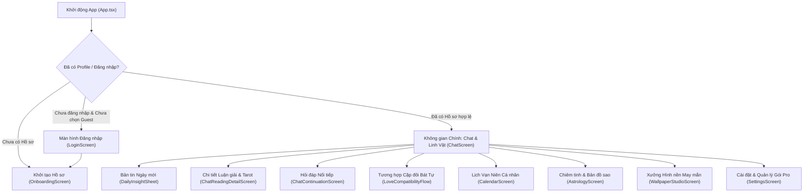

# TỔNG QUAN DỰ ÁN NUMELYRA MOBILE APP
*(Tài liệu Đặc tả Chức năng, Phạm vi Hệ thống & Mô hình Nghiệp vụ)*

---

## 1. Tổng Quan Dự Án (Project Overview)

### 1.1. Định vị sản phẩm
**NUMELYRA** là ứng dụng di động đa nền tảng (**iOS, Android, Web**) đóng vai trò như một **"Trợ lý Tâm linh & Huyền học Cá nhân hóa ứng dụng AI"** (Autonomous Spiritual AI Companion). Ứng dụng lấy hồ sơ cá nhân của người dùng (Họ tên, Ngày giờ sinh, Giới tính, Nơi sinh) làm "hạt giống dữ liệu" (data seed) để giải mã bản mệnh, dự báo năng lượng hàng ngày và đưa ra lời khuyên định hướng cuộc sống.

### 1.2. Triết lý sản phẩm: Giao thoa Đông – Tây & Công nghệ AI
Điểm khác biệt cốt lõi của NUMELYRA là sự kết hợp có hệ thống giữa các bộ môn huyền học phương Đông, phương Tây và Trí tuệ nhân tạo:
- **Huyền học Phương Đông**: Lịch Vạn Niên, Can Chi, Ngũ Hành Nạp Âm (60 Hoa Giáp), Tử Vi Đẩu Số, Bát Tự Tứ Trụ, Cung Phi Bát Trạch, Giờ xuất hành Lý Thuần Phong và kho tàng **Ca dao – Tục ngữ Việt Nam**.
- **Huyền học Phương Tây**: Hệ thống **24 chỉ số Thần số học Pythagoras**, **Tarot 78 lá** (Major & Minor Arcana), và **Chiêm tinh học hiện đại** (tính toán thiên văn học thực tế cho Bản đồ sao gốc Natal Chart & Vận hạn Transit).
- **Trí tuệ Nhân tạo (AI Agent)**: Bộ điều phối thông minh (`AgentDecisionEngine`) tự động phân tích câu hỏi để chọn đúng công cụ huyền học, kết hợp dữ liệu tính toán tất định (deterministic calculation) dưới thiết bị với khả năng diễn giải sâu sắc của mô hình ngôn ngữ lớn (LLM).

### 1.3. Kiến trúc & Công nghệ cốt lõi (Tech Stack)
- **Nền tảng & UI**: React Native `0.86.3`, Expo SDK `57`, React `19.2.3`, TypeScript `6.0`.
- **Điều hướng & Hoạt ảnh**: `@react-navigation/native-stack`, `react-native-reanimated`, `@lottiefiles/dotlottie-react`, hệ thống Sprite Animation riêng cho Linh vật Ngọn Lửa (Flame Mascot).
- **Cơ sở dữ liệu & Lưu trữ (Local-First)**:
  - `AsyncStorage`: Lưu trữ phiên đăng nhập, danh sách hồ sơ, cache bản tin ngày và cấu hình người dùng.
  - `expo-sqlite`: Vận hành 2 cơ sở dữ liệu cục bộ:
    1. `cadao.db` (Bundled Asset DB): Chứa kho Ca dao Tục ngữ Việt Nam, kho tri thức luận giải Thần số học (`numerology_knowledge` song ngữ Việt/Anh đã kiểm duyệt) và danh sách Nhân vật lịch sử đại diện (`representatives`).
    2. `numelyra_chat.db`: Lưu trữ phiên trò chuyện (`chat_sessions`) và tin nhắn (`chat_messages`) phục vụ hỏi đáp nối tiếp và đồng bộ đám mây theo lô.
- **Tính toán Chuyên biệt**: `astronomy-engine` (thiên văn học chiêm tinh), `@baostudio/viet-lunar` (âm lịch), `tz-lookup` (múi giờ theo tọa độ).
- **Backend & Đám mây**:
  - **Supabase**: Xác thực người dùng (Auth), lưu trữ hồ sơ đám mây (`profiles`, `user_numerology_profiles`), đồng bộ lịch sử chat và quản lý trạng thái gói cước (`subscriptions`).
  - **Next.js Backend API (`https://numelyra.online`)**: Cung cấp các endpoint AI streaming, phân loại ý định, tạo hình nền may mắn và cổng thanh toán.

---

## 2. Chức Năng Chi Tiết (Functional Architecture)

Kiến trúc giao diện hiện tại lấy **Không gian Trò chuyện (`ChatScreen`)** làm trung tâm (Main Scene), từ đó mở ra các màn hình chuyên biệt thông qua các nút cầu nổi (Floating Action Orbs) và ngăn xếp điều hướng (`NativeStackNavigator`).

### 2.1. Xác thực, Onboarding & Quản lý Đa Hồ Sơ
*Files chính: `src/screens/LoginScreen.tsx`, `src/screens/OnboardingScreen.tsx`, `src/store/authContext.tsx`, `src/store/profileContext.tsx`, `src/store/userProfile.ts`*
- **Đa phương thức truy cập**:
  - Đăng ký / Đăng nhập bằng Email & Mật khẩu.
  - Đăng nhập một chạm qua **Google OAuth** (hỗ trợ PKCE và Implicit flow trên cả Mobile & Web).
  - Khôi phục mật khẩu qua Email OTP / Recovery Link.
  - **Chế độ Khách (Guest Mode)**: Cho phép sử dụng ngay không cần tài khoản, tự động gộp (merge) dữ liệu cục bộ lên đám mây khi người dùng đăng nhập sau đó.
- **Hệ thống Đa Hồ Sơ (Multi-Profile Management)**:
  - Quản lý danh sách nhiều hồ sơ (bản thân, người yêu, thành viên gia đình, bạn bè).
  - Phân tách rõ **Hồ sơ chính (`Primary Profile`)** — dùng cố định cho Bản tin ngày mới, Thông báo đẩy và Tài khoản — với **Hồ sơ đang xem (`View Profile`)** linh hoạt tại từng màn hình.
  - Hỗ trợ dữ liệu sinh nâng cao cho Chiêm tinh: Giờ sinh (`exact` hoặc `unknown`) và Nơi sinh (`ResolvedBirthLocation` gồm kinh độ, vĩ độ, múi giờ). Dữ liệu tọa độ thô chỉ lưu cục bộ trên máy để dựng lá số, đảm bảo quyền riêng tư.

### 2.2. Trung tâm Trò chuyện AI & Linh vật Ngọn Lửa (Main Hub)
*Files chính: `src/screens/ChatScreen.tsx`, `src/services/agentDecisionEngine.ts`, `src/screens/ChatReadingDetailScreen.tsx`, `src/screens/ChatContinuationScreen.tsx`*
- **Không gian tương tác sống động**: Linh vật Ngọn Lửa (`FlameMascot`) có hoạt ảnh phản hồi theo ngữ cảnh (`idle`, `thinking`, `answer`), tự động chuyển đổi bảng màu năng lượng, kết hợp hiệu ứng mưa sao băng (`MeteorShower`) và mây trôi.
- **AI Agent Decision Engine (Bộ điều phối thông minh)**:
  Phân tích câu hỏi và số lượng hồ sơ được chọn (kết hợp API `/api/chat/classify` trên server và bộ lọc dự phòng dưới client) để quyết định luồng xử lý:
  1. **Chế độ Tương hợp 2 Hồ sơ (`compatibility` / `love_match`)**: Không rút Tarot; tự động kích hoạt bộ máy **Tử Vi Đẩu Số & Bát Tự Tứ Trụ (`tuViBaziService.ts`)** để chấm điểm hợp hôn (0–100%) dựa trên 6 tiêu chí: Nhật Chủ Ngũ Hành, Cung Phu Thê (Lục Hợp/Tam Hợp/Lục Xung/Tương Hại), Thiên Can Ngũ Hợp, Ngũ Hành Nạp Âm, Cung Phi Bát Trạch (Sinh Khí, Diên Niên, Thiên Y, Phục Vị...) và Địa Chi Con Giáp.
  2. **Chế độ Cá nhân 1 Hồ sơ (`single`)**:
     - `core_personality` (0 lá Tarot): Câu hỏi về bản thân, tính cách, sứ mệnh → Tra cứu trực tiếp từ 24 chỉ số Thần số học.
     - `daily_guidance` / `general` (1 lá Tarot): Lời khuyên tức thời → Rút 1 lá Tarot kết hợp chỉ số Thái độ & Linh hồn.
     - `color_guidance` (1 lá Tarot): Tư vấn trang phục/màu sắc hợp mệnh trong ngày (`colorGuidanceService.ts`).
     - `where_to_go` (1 lá Tarot + Định vị GPS): Gợi ý địa điểm đi chơi/hẹn hò/cà phê thực tế dựa trên vị trí hiện tại (`placeLocation.ts`) và năng lượng lá bài.
     - `timing_trajectory` (3 lá Tarot): Câu hỏi về xu hướng/tương lai gần → Trải bài 3 lá (Quá khứ – Hiện tại – Tương lai).
     - `two_choices` (5 lá Tarot): Câu hỏi phân vân giữa 2 ngã rẽ (A hay B) → Trải bài 5 lá đối chiếu ưu/nhược điểm từng phương án.
     - `trash`: Nhận diện ký tự vô nghĩa hoặc chào hỏi xã giao để phản hồi ngay mà không rút bài hay tiêu tốn lượt AI.
- **Trải nghiệm Đọc bài & Tương tác Đa phương thức**:
  - Hiệu ứng lật thẻ bài Tarot 3D (`TarotCardFlipView`) với bộ 78 lá bài minh họa riêng.
  - Hỗ trợ nhập câu hỏi bằng giọng nói (**Speech-to-Text** qua `voiceService.ts`) và nghe đọc luận giải (**Text-to-Speech** qua `ttsService.ts`).
  - Xem chi tiết luận giải trên trang giấy cổ (`ChatReadingDetailScreen`) và xem dấu vết suy luận huyền học (`MysticReadingTraceModal`).
- **Hỏi đáp Nối tiếp Chuyên sâu (`ChatContinuationScreen`)**:
  - Từ một bài luận giải gốc, người dùng có thể mở phiên hỏi đáp tiếp theo (tối đa **10 câu hỏi/phiên**).
  - Sử dụng cơ chế **SSE Streaming (`chatStreamClient.ts`)** để hiển thị câu trả lời AI theo thời gian thực và lưu trữ cục bộ vào SQLite (`numelyra_chat.db`).

### 2.3. Bản tin Ngày Mới (Daily Insight) & Thông báo Nhắc nhở
*Files chính: `src/features/daily-insight/dailyInsight.ts`, `src/features/daily-insight/DailyInsightSheet.tsx`, `src/services/dailyNotifications.ts`*
- **Tự động tổng hợp mỗi ngày**: Tự động mở sau 5 giây khi vào ứng dụng lần đầu trong ngày hoặc khi nhấn vào nút Mặt Trăng trên màn hình chính.
- **Nội dung Mặt trước (Miễn phí)**:
  - **Giờ Hoàng Đạo tốt nhất** trong khung giờ thức (07:00–22:00), đã loại trừ giờ xung tuổi/xung ngày và ưu tiên giờ Lý Thuần Phong tốt.
  - **Màu sắc May mắn (24 sắc thái)**: Tính toán từ vị trí Mặt Trăng hiện tại (Transit Moon Sign & Degree Phase) kết hợp Mặt Trời/Mặt Trăng gốc.
  - **Hướng Xuất hành**: Hướng Hỷ Thần & Tài Thần.
  - **Việc Nên làm & Nên tránh**: Chấm điểm tự động qua `activityRuleEngine.ts`.
  - **Chỉ số Năng lượng Chiêm tinh**: Tổng hợp từ góc chiếu các hành tinh trong ngày.
- **Nội dung Mặt sau (Chuyên sâu)**: Luận giải chi tiết và câu hỏi gợi ý cá nhân hóa (mở khóa qua hạn mức `daily_insight_back`).
- **Hệ thống Thông báo Cục bộ (`dailyNotifications.ts`)**: Lên lịch thông báo đẩy hàng ngày cho Bản tin sáng (giờ tùy chọn) và thông báo nhắc trước Giờ Hoàng Đạo kèm Deep Link (`numelyra://daily/YYYY-MM-DD`).

### 2.4. Hệ thống 24 Chỉ số Thần Số Học Pythagoras
*Files chính: `src/services/numerologyEngine.ts`, `src/services/numerology24Service.ts`, `src/components/NumerologyCardsModal.tsx`, `src/db/numerologyKnowledgeService.ts`*
- **Tính toán toàn diện 24 chỉ số**:
  - *Nhóm Cốt lõi*: Số Đường Đời, Sứ Mệnh, Linh Hồn, Nhân Cách, Ngày Sinh, Trưởng Thành, Tư Duy Lý Trí, Thái Độ, Cầu Nối Nội Tâm.
  - *Nhóm Nâng cao & Tiềm thức*: Đam Mê Tiềm Ẩn, Phản Ứng Tiềm Thức, Điểm Bảo Mật, Nợ Nghiệp (13/4, 14/5, 16/7, 19/1), Số Thiếu (Bài học nghiệp).
  - *Nhóm Chu kỳ & Dự báo*: Năm Cá Nhân, Tháng Cá Nhân, Ngày Cá Nhân, 3 Chu Kỳ Đường Đời, 4 Đỉnh Cao Đời Người (Pinnacles) & 4 Thử Thách (Challenges).
  - *Nhóm Biểu đồ*: Biểu đồ Ngày sinh, Biểu đồ Tên & **8 Mũi tên Cá tính** (Quyết tâm, Nhạy bén, Trí tuệ, Kế hoạch, Ý chí, Hoạt động, Nhạy cảm, Trống rỗng).
- **Kho Tri thức & Nhân vật Lịch sử**: Hiển thị luận giải chi tiết từ cơ sở dữ liệu offline `cadao.db` và đối chiếu với các nhân vật lịch sử nổi tiếng có cùng chỉ số Đường Đời (`HistoricalFigureModal.tsx`).

### 2.5. Chiêm Tinh Học Phương Tây & Lá Thăm Chiêm Tinh Dân Gian
*Files chính: `src/screens/AstrologyScreen.tsx`, `src/features/astrology/*`, `src/services/astro/*`*
- **3 Màn hình con chuyên sâu**:
  1. **Hôm nay (`AstrologyTodayView`)**: Bầu trời chiêm tinh hiện tại, vòng điểm năng lượng (`EnergyScoreRing`), vị trí các hành tinh quá cảnh (Transit) và phần rút **Lá Thăm Chiêm Tinh**.
  2. **Bản đồ sao gốc (`NatalChartView`)**: Vòng tròn Hoàng Đạo (`NatalChartWheel`) hiển thị 10 hành tinh (Mặt Trời, Mặt Trăng, Sao Thủy, Sao Kim, Sao Hỏa, Sao Mộc, Sao Thổ, Sao Thiên Vương, Sao Hải Vương, Sao Diêm Vương), Điểm Mọc (ASC), Thiên Đỉnh (MC) và 12 Cung Nhà (hệ Porphyry).
  3. **Chi tiết Hành tinh / Cung Nhà (`AstrologyDetailView`)**: Giải nghĩa từng vị trí hành tinh ở chế độ Natal (bẩm sinh) và Transit (hiện tại).
- **Lá Thăm Chiêm Tinh Dân Gian (`astroFortuneService.ts` & `astrologyCaDaoMatcher.ts`)**:
  - Kết hợp độc đáo giữa **Vector Chiêm tinh phương Tây** (Tension, Harmony, Conjunction scores, bộ quy tắc `astrologyRuleEvaluator`) với **Ca dao Việt Nam** được truy vấn theo ngữ cảnh từ `cadao.db`.
  - Gửi ngữ cảnh lên AI (`/api/astro/fortune`) để sinh ra một lá thăm gồm: **Thơ 4 câu – Gương soi – Kế sách hành động**.

### 2.6. Lịch Vạn Niên Cá Nhân Hóa
*Files chính: `src/screens/CalendarScreen.tsx`, `src/services/lunarService.ts`, `src/components/BlocDetailModal.tsx`, `src/components/HourDirectionSheet.tsx`*
- Giao diện lịch tờ (Bloc Calendar) nghệ thuật với hiệu ứng hoa đào rơi (`FallingCherryPetals`) và linh vật theo mùa.
- Đổi ngày Dương – Âm lịch, tính Can Chi Ngày/Tháng/Năm, Ngũ hành Nạp âm, Tiết khí, Trực ngày, Sao tốt/xấu.
- Bảng kéo **12 Giờ Hoàng Đạo / Hắc Đạo (`HourDirectionSheet`)**, đánh dấu giờ hiện tại, giờ tốt nhất xuất hành và cảnh báo giờ/ngày xung khắc trực tiếp với tuổi Con Giáp của hồ sơ đang xem.
- Hiển thị câu Ca dao – Tục ngữ tương ứng với từng ngày.

### 2.7. Xưởng Hình Nền May Mắn (Lucky Wallpaper Studio)
*Files chính: `src/screens/WallpaperStudioScreen.tsx`, `src/services/wallpaperSaver.ts`, `src/services/wallpaperHistoryCache.ts`*
- Quy trình 3 bước: **Nhập ý nguyện (Input)** → **Khởi tạo 60fps (Generating)** → **Thư viện Kết quả (Carousel Result)**.
- Tự động kết hợp Số Đường Đời, Ngày Cá Nhân, Màu sắc may mắn với 6 phong cách nghệ thuật (*Hình học thiêng, 3D ánh hoàng kim, Thiền tĩnh huyền bí, Vũ trụ cung hoàng đạo, Thiên nhiên mộng mơ, Tối giản*) và 6 ý niệm thu hút (*Tài lộc, Tình duyên, An lạc, Sự nghiệp, Bảo hộ, Chữa lành*).
- Tạo ảnh AI qua `/api/lucky-wallpaper/generate`, đính kèm câu khẳng định thu hút năng lượng (**Affirmation** song ngữ Việt/Anh), lưu bộ nhớ đệm cục bộ và tải trực tiếp về thư viện ảnh trên máy.

### 2.8. Cài đặt, Đa ngôn ngữ & Đồng bộ Đám mây
*Files chính: `src/screens/SettingsScreen.tsx`, `src/i18n/LocalizationContext.tsx`, `src/components/CloudSyncPill.tsx`, `src/services/chatSessionSyncService.ts`*
- **Đa ngôn ngữ (i18n)**: Chuyển đổi tức thì giữa Tiếng Việt (`vi`), Tiếng Anh (`en`) hoặc Tự động theo hệ thống (`system`), áp dụng cho cả giao diện, dữ liệu luận giải và prompt gửi lên AI.
- **Đồng bộ Đám mây Thông minh**: Hiển thị trạng thái qua `CloudSyncPill`, quản lý đồng bộ hồ sơ và đồng bộ tin nhắn chờ (tự động đẩy lên Supabase theo lô 10 tin nhắn hoặc đồng bộ thủ công trong Cài đặt).

---

## 3. Phạm Vi Dự Án (Project Scope)

### 3.1. Trong phạm vi dự án Mobile App (In-Scope)
| Hạng mục | Chi tiết phạm vi trong Repository hiện tại |
| :--- | :--- |
| **Ứng dụng Client đa nền tảng** | Toàn bộ mã nguồn ứng dụng cho **Android**, **iOS** và **Web** trên nền tảng Expo SDK 57. |
| **Bộ máy Tính toán Cục bộ (Offline Engines)** | 100% thuật toán tính 24 chỉ số Thần số học, Lịch Âm Dương & Can Chi, Tử Vi Bát Tự & Chấm điểm hợp hôn, Thiên văn học Bản đồ sao & Vector Chiêm tinh, Đánh giá việc nên làm/tránh, Rút bài Tarot ngẫu nhiên đều chạy trực tiếp trên thiết bị mà không cần mạng. |
| **Cơ sở dữ liệu Nội bộ** | Quản lý và truy vấn SQLite `cadao.db` (Ca dao, Tri thức Thần số học, Nhân vật lịch sử) và `numelyra_chat.db` (Lịch sử phiên chat). |
| **Luồng Đồng bộ & Xác thực** | Tích hợp Supabase Auth, cơ chế hợp nhất (merge) hồ sơ Guest/Cloud, bảo vệ chống rò rỉ cache giữa các tài khoản khác nhau trên cùng thiết bị. |
| **Tích hợp Thanh toán & Quyền lợi** | Luồng mua gói Pro qua **Google Play Billing (`expo-iap`)** trên Android và **PayOS / PayPal** trên iOS/Web, cùng giao diện quản lý hạn mức (Quota UI). |
| **Kiểm thử Tự động (Automated Tests)** | Hệ thống Unit & Integration Test với Jest (`jest-expo`) bao phủ các engine tính toán, kiểm toán bất biến chiêm tinh (`astroInvariantAudit`), kiểm toán 30 ngày Daily Insight (`dailyInsightThirtyDayAudit`), đồng bộ hồ sơ và dịch thuật. |

### 3.2. Ngoài phạm vi repo này / Phụ thuộc Hệ thống Ngoài (Out-of-Scope & External Dependencies)
- **Hệ thống Backend Server (`https://numelyra.online`)**:
  - Mã nguồn máy chủ Next.js xử lý việc gọi LLM (DeepSeek/OpenAI) và quản lý Prompt bảo mật cho các endpoint: `/api/chat/agent`, `/api/chat/continue`, `/api/chat/classify`, `/api/bazi-love/reading`, `/api/astro/fortune`, `/api/lucky-wallpaper/generate`.
  - Xử lý Webhook thanh toán từ PayOS, PayPal, Google Play Real-time Developer Notifications và lưu trữ sổ cái hạn mức (Quota Ledger) phía server.
- **Các hạng mục đã lược bỏ so với tài liệu cũ**:
  - *Mini-game Hub (`src/games/`)* và *Thanh điều hướng đáy (Bottom Tab Bar)* trong `README.md` cũ đã được loại bỏ khỏi phạm vi hiện tại để tập trung hoàn toàn vào kiến trúc "Không gian Trò chuyện Trung tâm" (Scene-based Hub).

---

## 4. Mô Hình Kinh Doanh & Nghiệp Vụ (Business Model & Logic)

### 4.1. Mô hình Doanh thu: Freemium & Gói Đăng ký (NUMELYRA Pro)
Dự án vận hành theo mô hình **Freemium** với 3 tầng người dùng:
1. **Khách (Guest)**: Trải nghiệm miễn phí các công cụ tính toán cục bộ (Lịch Vạn Niên, Bản đồ sao gốc, mặt trước Daily Insight, tra cứu 24 chỉ số cơ bản), nhưng cần đăng nhập để nhận hạn mức hỏi đáp AI và đồng bộ đám mây.
2. **Tài khoản Miễn phí (Free Tier)**: Có hạn mức cơ bản hàng tháng/ngày để trải nghiệm hỏi đáp AI, rút lá thăm chiêm tinh và tạo hình nền.
3. **Tài khoản Cao cấp (NUMELYRA Pro / Premium)**: Mở khóa hạn mức cao (ví dụ: **200 lượt phản hồi AI/tháng**), mở khóa luận giải chuyên sâu mặt sau Daily Insight, tạo hình nền may mắn và huy hiệu VIP.

### 4.2. Kênh Thanh toán Đa Nền tảng (Payment Gateways)
Hệ thống thanh toán được phân tách chặt chẽ theo quy định của từng kho ứng dụng (`src/services/billingService.ts` & `src/screens/SettingsScreen.tsx`):
- **Trên Android**: Sử dụng độc quyền **Google Play In-App Billing (`expo-iap`)** với mã gói đăng ký `numelyra_pro_monthly` (Base Plan: `monthly`), gắn định danh bảo mật `googlePlayObfuscatedAccountId` và xác thực biên lai qua `/api/billing/google-play/verify`. Hỗ trợ khôi phục giao dịch (`restoreGooglePlayPurchases`).
- **Trên iOS / Web**: Hỗ trợ thanh toán qua cổng nội địa **VietQR / PayOS** (`249.000đ/tháng`) và cổng quốc tế **PayPal** (`$9.99/tháng`) thông qua phiên trình duyệt bảo mật.

### 4.3. Nghiệp vụ Quản lý Hạn mức (Quota & Entitlement Engine)
*Files chính: `src/store/billingContext.tsx`, `src/services/billingService.ts`, `src/components/chat/MonthlyChatQuotaBar.tsx`*

Hệ thống kiểm soát tài nguyên đám mây qua 4 loại hạn mức (Quota):
1. **`ai_response`**: Lượt hỏi đáp AI ở màn hình Chat chính, Luận giải Bát Tự Tình Duyên và các câu hỏi nối tiếp (`ChatContinuationScreen`). Hiển thị trực quan qua thanh `MonthlyChatQuotaBar` với 3 ngưỡng cảnh báo màu sắc:
   - `normal`: Còn trên 20% số lượt.
   - `low`: Còn $\le 20\%$ số lượt (chuyển sang tông vàng cam cảnh báo).
   - `empty`: Hết lượt (`remaining = 0`, chuyển sang tông hồng đỏ và gợi ý nâng cấp Pro).
2. **`daily_insight_back`**: Lượt mở khóa mặt sau (phân tích chuyên sâu) của thẻ Bản tin Ngày mới (`/api/daily-insight/unlock`, có cơ chế idempotent theo `profileKey` + `localDate` để không trừ trùng lượt trong cùng một ngày).
3. **`wallpaper`**: Lượt khởi tạo hình nền AI trong Xưởng Hình Nền May Mắn.
4. **`astro_fortune`**: Hạn mức rút "Lá Thăm Chiêm Tinh Dân Gian" theo ngày (`/api/astro/fortune`).

> **Cơ chế Bảo vệ Hạn mức Người dùng (Optimistic Debit & Rollback)**:
> Khi người dùng gửi câu hỏi, ứng dụng tạm trừ hạn mức trên UI (`consumeQuota`) để phản hồi tức thì. Nếu quá trình gọi mạng gặp lỗi hoặc bị gián đoạn trước khi Server xác nhận, ứng dụng tự động hoàn lại lượt (`restoreQuota`) để người dùng không bị mất quyền lợi oan.

### 4.4. Chiến lược Giữ chân Người dùng (Retention Loops) & Tối ưu Chi phí (Unit Economics)
- **Vòng lặp Thói quen Hàng ngày (Daily Habit Loop)**:
  `Thông báo đẩy buổi sáng / Giờ Hoàng Đạo` $\rightarrow$ `Mở ứng dụng tự động hiển thị Daily Insight` $\rightarrow$ `Kiểm tra Lịch Vạn Niên / Lá Thăm Chiêm Tinh` $\rightarrow$ `Bấm vào câu hỏi gợi ý để trò chuyện cùng AI`.
- **Vòng lặp Mở rộng Mạng lưới (Viral / Family Loop)**:
  Tính năng **Đa Hồ Sơ** và **Ghép đôi Bát Tự Tình Duyên** khuyến khích người dùng nhập thêm thông tin của người yêu, bạn bè, gia đình để xem tương hợp và xem vận hạn hộ, từ đó gia tăng tần suất sử dụng lượt AI và thúc đẩy chuyển đổi lên gói Pro.
- **Tối ưu Chi phí Hạ tầng & AI (Cost Efficiency)**:
  - **Pre-computing tại Client**: Toàn bộ dữ liệu phức tạp (24 chỉ số Thần số học, lá số Bát Tự, tọa độ hành tinh, góc chiếu, chọn câu Ca dao phù hợp) đều được tính toán bằng CPU của điện thoại người dùng. Server chỉ nhận kết quả đã chắt lọc để tổng hợp văn bản, giúp giảm mạnh lượng token đầu vào và độ trễ phản hồi.
  - **Chặn câu hỏi rác tại biên (`Trash Prompt Filtering`)**: Các câu nhập thử nghiệm, ký tự vô nghĩa được chặn ngay hoặc trả lời mẫu mà không gọi LLM chuyên sâu.
  - **Đồng bộ Đám mây theo Lô (`Batch Syncing`)**: Tin nhắn trò chuyện được lưu vào SQLite cục bộ trước và chỉ đẩy lên Supabase khi tích lũy đủ **10 tin nhắn** (`PENDING_SYNC_THRESHOLD = 10`) hoặc khi người dùng chủ động đồng bộ, giúp tiết kiệm đáng kể băng thông và chi phí đọc/ghi cơ sở dữ liệu đám mây.

